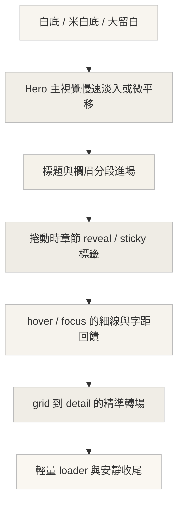

# 日系時尚雜誌感的創意動效與網頁設計模式研究

## 執行摘要

SankouDesign 的分類本身就很接近你要的方向：它把「雜誌風なレイアウト」「魅力的な文字･タイポグラフィ」「縦書き」「日本語主体」「白黑／落ち着いた／スタイリッシュ配色」與「ほぼ動きなし･動き少なめ」「リッチ･印象的･細やかな動き」「スマホ特化･モバイルファースト」放在同一套篩選系統裡。這代表「日本時尚雜誌感」最有效的做法，不是滿版炫技，而是用少量、精準、編輯式的動作去支撐留白、攝影、字體階層與捲動節奏。citeturn4search2turn27view0turn27view1turn35view0

我認為最接近這種氣質的參考軸線，是從 SankouDesign 的分類法，連到 entity["organization","Lula Japan","japanese fashion magazine"] 以單一期刊主題色構成完整世界觀、entity["company","UNIQLO","japanese apparel brand"] 的 LifeWear magazine 把產品敘事做成 editorial commerce、entity["company","Maison Margiela","french fashion house"] 與 entity["known_celebrity","Nick Knight","fashion photographer"] 強調 moving imagery 的首頁語言，以及 entity["organization","North Six","creative collective"] Yearbook 那種把印刷刊物閱讀經驗帶進數位互動的方式。citeturn9view0turn21view0turn30view0turn30view1turn14view1turn11search4turn16view0

如果要把這種感覺落地成 HTML/CSS/JS，我最推薦的骨架是：首屏只做一個慢速 cover 動作；hover 只做細線、字距、透明度或裁切；scroll reveal 只做 opacity、translate、clip-path；parallax 保持柔和而非大幅位移；grid/detail 轉場優先用 View Transition API 或輕量 FLIP；手機上把 hover 改成 tap/scroll-snap，並完整支援 `prefers-reduced-motion`。這些做法和官方文件所建議的 `IntersectionObserver`、`clip-path`、`mask-image`、`hover` media query、`aspect-ratio`、`object-fit`、`scroll-snap-type` 與 reduced motion 模式都能直接相容。citeturn33view1turn32view8turn32view9turn32view2turn32view3turn32view4turn32view6turn33view0

以下凡是官方網站或案例頁沒有公開前端 stack、easing、duration、library 名稱的地方，我都會標成 **unspecified**；該處的實作筆記屬於根據公開畫面語言、案例描述與 Web 平台能力所做的可重建方案。citeturn21view0turn30view0turn14view1turn16view0

## 以 SankouDesign 為核心的風格框架

從 SankouDesign 的篩選邏輯來看，最能對應「日系時尚雜誌感」的不是單一標籤，而是一組同時成立的條件：**簡潔／上品／高級感／知性配色／雜誌式編排／字體存在感／日文可讀性／必要時的縱排與強烈攝影**，再配上**少量動效或細膩動作**，而不是整頁都在移動。這和日本時尚媒體常見的「先讓畫面能被閱讀，再讓動作去帶視線」非常一致。citeturn4search2turn27view0turn27view1turn35view0

以內容策略來看，Lula Japan 明確把每一期建立在一個來自日本傳統色的主題上，並且希望雜誌同時帶有時尚媒體與藝術書的表現力；UNIQLO 的 LifeWear magazine 則把品牌概念、造型、商品與訪談放入同一個 editorial 容器；North Six Yearbook 更直接把大開本設計／攝影刊物的閱讀方式轉成數位章節、書籤與主題導覽。這三條線索的共同點，是**把 motion 當成編輯節奏，而不是把 motion 當成表演**。citeturn9view0turn21view0turn30view0turn30view1turn16view0

如果你想把質地往東京文化誌再推一點，可看 entity["organization","sabukaru","tokyo media collective"] 的首頁密度、分類絲帶、圖像裁切與文章卡節奏；它更適合作為**版面密度、影像裁切與欄位節奏**的參考，公開文本中的具體 motion stack 則屬 **unspecified**。citeturn20search0turn20search11

把這些來源綜合起來，我建議的 motion hierarchy 如下：先用靜態留白定基調，再用首屏慢速動作建立封面感，接著用 scroll-triggered reveal 把章節打開，最後只用極小的 hover/focus 給出閱讀回饋。這種層級最接近「日本時尚雜誌在網頁上的翻頁感」。citeturn27view0turn27view1turn14view1turn16view0turn31view0turn31view2



## 範例總表

下表先把最值得看的官方網站、案例頁與可重製 demo 放在同一張表裡；後面再逐類拆解哪種動效適合拿來直接臨摹、哪種比較適合當概念層靈感。

| Site name | URL | Effect type | Brief notes |
|---|---|---|---|
| SankouDesign | `https://sankoudesign.com/` | 風格與動效分類庫 | 不是單一範本站，而是能用「雜誌風」「魅力的な文字」「動き少なめ／細やかな動き」「スマホ特化」交叉過濾的策展入口。citeturn26search5turn4search2turn35view0 |
| Lula Japan | `https://lulamag.jp/` | 期刊式首頁／主題色編排 | 以 Fashion／Art&Culture／Beauty／Encounter 分流，並以 issue 與 special feature 維持期刊感；公開頁未揭露前端 stack，屬 unspecified。citeturn21view0turn9view0 |
| UNIQLO LifeWear magazine | `https://www.uniqlo.com/jp/en/contents/lifewear-magazine/` | Editorial commerce／styling story | 官方明說成立 magazine 是為了探索服裝與其概念，站內同時有 styling、back number、shop the look。citeturn30view0turn30view1turn30view2 |
| Maison Margiela Global Relaunch | `https://intmagic.com/project/maison-margiela` | Hero moving imagery／video-led interface | International Magic 明說是 video-driven、put moving imagery first，而且設計要在 every device 之間「melodically」移動。citeturn14view1turn11search4 |
| North Six Yearbook | `https://madebyon.com/case-studies/north-six-yearbook/` | Scroll typography／micro-interaction／editorial navigation | 以年鑑與咖啡桌書為原型，包含 bookmark、shuffle、逐字亮顯 quotation、Explore/Read cursor。citeturn16view0 |
| sabukaru.online | `https://sabukaru.online/` | 影像主導雜誌網格 | Tokyo-based media collective，適合作欄位密度、分類絲帶與圖像裁切參考；動效細節 unspecified。citeturn20search0turn20search11 |
| On-Scroll Typography Animations | `https://tympanus.net/codrops/2023/01/18/on-scroll-typography-animations/` | 捲動字體動畫 | Codrops 提供 demo 與 GitHub 原始碼，且明確指出此法很適合 editorial 區塊，但不宜濫用。citeturn31view0turn31view1 |
| Double Image Hover Effects | `https://tympanus.net/codrops/2023/03/01/double-image-hover-effects-with-clip-path-animations/` | Hover reveal／clip-path masking | 以同圖二次揭露、濾鏡與 transform 建立非常適合 fashion image hover 的細膩效果。citeturn31view2turn31view3 |
| Elastic Grid Scroll | `https://github.com/codrops/ElasticGridScroll` | 柔和 parallax | 各欄位以不同速度移動，形成 soft, elastic 的 scroll 感，不是暴力視差。citeturn31view5 |
| Animated Grid Previews | `https://github.com/codrops/AnimatedGridPreviews` | 散點到網格轉場 | 零散圖像按一下 Explore 後收束成 grid，很適合 lookbook／issue preview。citeturn31view4 |
| Menu to Grid Layout Animation | `https://tympanus.net/codrops/2022/09/19/menu-to-grid-layout-animation/` | Grid/portfolio transition | 將 menu row 的縮圖轉入 grid preview，適合「目錄 → 專題頁」結構。citeturn31view6turn25search2 |
| Kinetic Typography Page Transition | `https://github.com/codrops/KineticTypePageTransition` | Typography-led page transition | 字體由背景走到前景、帶出新內容，適合 issue title、section title 的高辨識轉場。citeturn31view7turn25search8 |
| Grid Loading Effects | `https://github.com/codrops/GridLoadingEffects` | Grid loading／opening animation | 逐格顯示的載入方式很適合攝影網格、商品圖牆與 feature mosaic。citeturn31view9 |
| graniph case study | `https://www.tacchistudios.com/case-studies/graniph/` | Mobile quick-access microinteraction | 案例很清楚說明行動裝置上「立即看到新品」與 native-feeling microinteraction 的價值。citeturn15view0 |

## 九類最適合的動效與互動模式

**Hero 動畫｜封面式慢速主視覺與標題淡入**  
最像日系時尚雜誌首頁的 hero，不是大型 3D，不是浮誇 shader，而是**一張高質感大圖或極短 loop video + 一段很慢的平移/縮放 + 兩層標題淡入**。Maison Margiela 的案例明確把 moving imagery 放在前面；Lula Japan 把 issue 與主題色當成世界觀入口；UNIQLO LifeWear magazine 也把品牌概念包進 editorial cover 的節奏裡。公開頁面都沒有公開 production code，因此精準 stack 屬 **unspecified**，但視覺邏輯非常清楚。citeturn14view1turn11search4turn9view0turn21view0turn30view0turn30view2

原始碼／案例可先看：`https://intmagic.com/project/maison-margiela`、`https://lulamag.jp/`、`https://www.uniqlo.com/jp/en/contents/lifewear-magazine/`。citeturn14view1turn21view0turn30view0

下面這段是最小可用版：只靠 `transform`、`opacity` 與 `prefers-reduced-motion` 就能做出「封面慢動」的感覺。MDN 對 `transform` 與 reduced motion 的行為都有明確說明。citeturn22search3turn33view0

```html
<header class="hero">
  
  <div class="hero__inner">
    <p class="hero__kicker">ISSUE 24 — nae-iro</p>
    <h1 class="hero__title">Quiet Color, Moving Fabric</h1>
  </div>
</header>
```

```css
.hero{
  position:relative;
  min-height:100svh;
  overflow:hidden;
  background:#f6f4ef;
  color:#111;
}
.hero__img{
  position:absolute;
  inset:0;
  width:100%;
  height:100%;
  object-fit:cover;
  transform:scale(1.04);
  animation:hero-pan 8s cubic-bezier(.22,1,.36,1) forwards;
}
.hero__inner{
  position:relative;
  z-index:1;
  padding:min(12vh,96px) clamp(24px,6vw,80px);
}
.hero__kicker,
.hero__title{
  opacity:0;
  transform:translateY(16px);
  animation:fade-up .9s cubic-bezier(.22,1,.36,1) forwards;
}
.hero__title{
  animation-delay:.2s;
  font-family:"Noto Serif JP", serif;
  letter-spacing:.03em;
  max-width:10ch;
}
@keyframes hero-pan{to{transform:scale(1)}}
@keyframes fade-up{to{opacity:1;transform:none}}
@media (prefers-reduced-motion: reduce){
  .hero__img,.hero__kicker,.hero__title{animation:none;transform:none;opacity:1}
}
```

**Micro-interactions｜細線、字距、裁切，而不是大按鈕**  
North Six Yearbook 的 micro-interaction 很值得學：游標在不同可讀區塊上從「Explore」切成「Read」，等於不用塞滿 CTA 也能讓人理解層級。另一方面，entity["organization","Codrops","web design publisher"] 的 Double Image Hover Effects 示範了很典型的 fashion hover：用 `clip-path`、`filter` 與 `transform` 去做「同圖再揭露」，細膩、乾淨，而且不會破壞版面靜態感。這種做法非常像雜誌頁面上的細節提示，而不是 App 式大按鈕。citeturn16view0turn31view2turn31view3

原始碼／案例：`https://github.com/codrops/DoubleImageHoverEffects`、`https://tympanus.net/codrops/2023/03/01/double-image-hover-effects-with-clip-path-animations/`。North Six 的實際 stack 未公開，屬 **unspecified**。citeturn31view2turn31view3turn16view0

實作上請一定把 hover 限制在可 hover 的裝置，手機不要把重要資訊鎖在 hover 狀態裡；MDN 對 `@media (hover: hover)` 的用途有清楚說明。citeturn32view2

```html
<a class="editorial-link" href="#">
  <span>Read the story</span>
</a>
```

```css
.editorial-link{
  position:relative;
  display:inline-block;
  color:#111;
  text-decoration:none;
  letter-spacing:.08em;
}
.editorial-link::after{
  content:"";
  position:absolute;
  left:0; right:0; bottom:-0.25rem;
  height:1px;
  background:currentColor;
  transform:scaleX(0);
  transform-origin:left center;
  transition:transform .24s ease;
}
@media (hover: hover){
  .editorial-link:hover::after,
  .editorial-link:focus-visible::after{
    transform:scaleX(1);
  }
  .editorial-link:hover span,
  .editorial-link:focus-visible span{
    letter-spacing:.12em;
    transition:letter-spacing .24s ease;
  }
}
```

**Scroll-triggered transitions｜章節 reveal 與逐字亮顯**  
North Six Yearbook 把 quotation 做成**隨捲動逐字亮起**，讓閱讀像被朗讀；Codrops 的 On-Scroll Typography Animations 也直接說這類字體動作很適合 editorial piece，但不要過度使用。技術上，如果只是「進視窗時 reveal」，原生 `IntersectionObserver` 就很夠，而且 MDN 明確指出它能避免傳統 scroll handler + `getBoundingClientRect()` 那種主執行緒負擔；若你需要 scrub、pin、snap，GSAP ScrollTrigger 才值得上場。citeturn16view0turn31view0turn31view1turn33view1turn33view2

原始碼／文件：`https://github.com/codrops/OnScrollTypographyAnimations`、`https://gsap.com/docs/v3/Plugins/ScrollTrigger/`。citeturn31view1turn33view2

```html
<section class="reveal js-reveal">
  <p class="section-kicker">Chapter One</p>
  <h2>Soft tailoring, sharp spacing.</h2>
</section>
```

```css
.reveal{
  opacity:0;
  transform:translateY(24px);
  transition:
    opacity .7s ease,
    transform .7s cubic-bezier(.22,1,.36,1);
}
.reveal.is-in{
  opacity:1;
  transform:none;
}
```

```js
const io = new IntersectionObserver((entries) => {
  entries.forEach((entry) => {
    entry.target.classList.toggle("is-in", entry.isIntersecting);
  });
}, {
  threshold: 0.15,
  root: null,
  rootMargin: "0px 0px -10% 0px"
});

document.querySelectorAll(".js-reveal").forEach((el) => io.observe(el));
```

**Parallax｜柔和分層，不做大位移背景漂移**  
Elastic Grid Scroll 的重點不是「很多東西飛來飛去」，而是**每一欄以略微不同速度捲動**，形成柔軟的延遲感；Ruud Luijten 的 parallax slider 則把 scroll/drag 與 CSS Grid 結合，適合用在 lookbook 或 issue feature 的圖像序列。這種 parallax 最適合日本時尚雜誌感，因為它像翻厚紙時圖層之間的相對滑動，而不是遊戲式景深展示。citeturn31view5turn37view0

原始碼／案例：`https://github.com/codrops/ElasticGridScroll`、`https://github.com/rluijten/codrops-parallax-slider`。citeturn31view5turn37view0

實作上建議把位移限制在視窗高度的 **6%–12%** 之間，圖層最多 2–3 層。若真的需要硬體合成優化，`will-change` 只能針對少數熱區短時間使用，MDN 明確警告不要長駐在大量元素上。citeturn33view3

```html
<section class="parallax" data-speed="0.12">
  
</section>
```

```css
.parallax{
  overflow:hidden;
}
.parallax img{
  display:block;
  width:100%;
  transform:translateY(calc(var(--offset, 0) * 1px));
  transition:transform .08s linear;
}
```

```js
const parallaxEls = [...document.querySelectorAll(".parallax")];

function updateParallax() {
  parallaxEls.forEach((el) => {
    const rect = el.getBoundingClientRect();
    const speed = parseFloat(el.dataset.speed || "0.1");
    const center = rect.top + rect.height / 2;
    const delta = window.innerHeight / 2 - center;
    el.style.setProperty("--offset", (delta * speed).toFixed(2));
  });
}
addEventListener("scroll", updateParallax, { passive: true });
addEventListener("resize", updateParallax);
updateParallax();
```

**Typography animations｜靠字重、字距、透明度做戲**  
對日本時尚雜誌感來說，字不是 label，而是畫面結構的一部分。Codrops 的 On-Scroll Typography 與 Kinetic Typography Page Transition 都把 type 當作主要角色；MDN 則說 `font-variation-settings` 能直接控制 variable font 軸；entity["company","Adobe","software company"] 的 Source Han Sans JP Variable 明確支援可變字重，而 Google Fonts 的 Noto Serif JP 也支援日文腳本。這表示你完全可以做出「Kana/漢字靜、英數動」或「標題字重由 350 拉到 650」這種非常雜誌化的微動畫。citeturn31view0turn31view7turn34view0turn34view2turn24search2

原始碼／案例：`https://github.com/codrops/KineticTypePageTransition`、`https://github.com/codrops/OnScrollTypographyAnimations`。citeturn31view7turn31view1

建議不要把整段 CJK 文本拆成大量 span 做逐字動畫，否則可讀性、語意與效能都會下降。更好的做法是只對**標題、欄眉、引用、英數副標**做字距與字重變化。citeturn31view0turn34view0

```html
<h2 class="vf-title">TOKYO / SPRING / ISSUE</h2>
```

```css
.vf-title{
  font-family:"Source Han Sans JP Variable", "Noto Sans JP", sans-serif;
  font-variation-settings:"wght" 350;
  letter-spacing:.18em;
  opacity:.35;
  transition:
    font-variation-settings .8s ease,
    letter-spacing .8s ease,
    opacity .6s ease;
}
.vf-title.is-in{
  font-variation-settings:"wght" 680;
  letter-spacing:.05em;
  opacity:1;
}
```

**Image reveal / masking｜裁切揭露比縮放更像雜誌**  
Codrops 的 Double Image Hover Effects 與 Fullscreen Clip Effect 都證明了：對時尚圖像來說，**揭露**通常比**放大縮小**更高級。平台能力上，MDN 明確說 `clip-path` 是建立可見區域，`mask-image` 則可以用 alpha 或漸層去柔化邊界。這很適合模擬雜誌中的遮片、切角、局部覆蓋與紙張邊緣。citeturn31view2turn25search3turn32view8turn32view9

原始碼／案例：`https://github.com/codrops/DoubleImageHoverEffects`、`https://github.com/codrops/FullscreenClipEffect`。citeturn31view3turn25search3

```html
<figure class="mask-reveal is-in">
  
</figure>
```

```css
.mask-reveal{
  overflow:hidden;
}
.mask-reveal img{
  display:block;
  width:100%;
  clip-path:inset(0 100% 0 0);
  transition:clip-path .9s cubic-bezier(.22,1,.36,1);
}
.mask-reveal.is-in img{
  clip-path:inset(0 0 0 0);
}

/* 若想邊緣更柔 */
.mask-reveal.soft img{
  mask-image:linear-gradient(to right, #000 72%, transparent 100%);
}
```

**Grid / portfolio transitions｜從目錄到專題頁的「打開」感**  
Animated Grid Previews 把散落縮圖收成 grid；Menu to Grid 用 GSAP Flip 把 menu row 的縮圖送進 content preview；Animated Product Grid Preview 則是把 product card 展成更完整的預覽。Chrome 與 MDN 的 View Transition API 文件都強調，這類「thumbnail → full image」「grid filter 重排」正是 API 最典型的使用情境，而且同文檔與跨文檔都能做。這對時尚 lookbook、issue archive、cover list 特別合用。citeturn31view4turn31view6turn38search0turn38search3turn32view0turn32view1turn36view2

如果你是傳統 MPA，現在可以先用 `@view-transition { navigation: auto; }` 做 progressive enhancement；web.dev 與 MDN blog 都指出，same-document view transitions 在 2025 年已進入 Baseline Newly available，而多頁面的 CSS view transitions 也已能在 Chrome、Edge 與 Safari 上作為漸進增強使用。citeturn36view0turn36view1

原始碼／案例：`https://github.com/codrops/AnimatedGridPreviews`、`https://github.com/codrops/MenuToGrid`、`https://tympanus.net/codrops/2025/05/27/animated-product-grid-preview-with-gsap-clip-path/`。citeturn31view4turn25search2turn38search0

```html
<!-- page A -->
<a class="card" href="/detail.html">
  
</a>
```

```css
@view-transition{
  navigation:auto;
}

/* 注意：真正上線時，對每個被點擊項目給唯一的 view-transition-name */
.card__img{
  view-transition-name:look-01;
}

::view-transition-old(look-01),
::view-transition-new(look-01){
  animation-duration:.45s;
  animation-timing-function:cubic-bezier(.22,1,.36,1);
}
```

**Loading animations｜纖細線條、頁碼感、逐格載入**  
SankouDesign 把 loading/opening animation 明確列成一類，但在你要的美學裡，loader 應該更接近**頁碼、欄線、封面拉頁**，而不是 logo 爆炸。Codrops 的 Creative CSS Loading Animations 與 Grid Loading Effects 都適合拿來作為極簡 loader 的語法靈感；如果頁面是影像網格，逐格淡入會比整頁黑底開場更符合 fashion editorial 的節奏。citeturn27view0turn27view1turn31view8turn31view9

原始碼／案例：`https://github.com/codrops/GridLoadingEffects`、`https://tympanus.net/codrops/2012/11/14/creative-css-loading-animations/`。citeturn31view8turn31view9

如果你有長篇內容或大量圖片，loader 最好和實際資源策略一起考慮；MDN 對 lazy loading 與 `content-visibility` 都說得很明白：先減少不必要的初始渲染，比做漂亮 loader 更有價值。citeturn32view5turn32view7

```html
<div class="line-loader" aria-hidden="true"></div>
```

```css
.line-loader{
  position:fixed;
  inset:0 auto auto 0;
  width:100%;
  height:2px;
  background:transparent;
  z-index:999;
}
.line-loader::before{
  content:"";
  display:block;
  width:100%;
  height:100%;
  background:#111;
  transform-origin:left center;
  animation:loadline 1.1s cubic-bezier(.22,1,.36,1) infinite;
}
@keyframes loadline{
  0%{transform:scaleX(0)}
  60%{transform:scaleX(.72)}
  100%{transform:scaleX(1)}
}
```

**Responsive / mobile behavior｜手機上保留期刊感，不保留桌面 hover 迷思**  
SankouDesign 直接把 mobile-first 作為主要篩選維度，而 Tacchi 對 graniph 的案例也說得很清楚：行動端的關鍵不是把桌面縮小，而是讓使用者**立即看到新品與主內容**，並維持 native-feeling 的微互動。MDN 也明確指出，`hover` media feature 能分辨裝置是否真的可 hover；`aspect-ratio` 與 `object-fit` 能穩定攝影裁切；`scroll-snap-type` 適合 story-like 區塊；`prefers-reduced-motion` 能降低大位移動畫；`lazy loading` 與 `content-visibility` 則能加速長篇 editorial 的初始渲染。citeturn35view0turn15view0turn32view2turn32view3turn32view4turn32view5turn32view6turn32view7turn33view0

在手機上，我會把版式改成**單欄故事流**，並用 `scroll-snap` 讓大圖章節停在舒服位置；所有 hover-only 資訊都改成直接顯示、tap 切換或 focus-visible；圖片則必須預先定義比例，避免 CLS 破壞期刊感。citeturn35view0turn15view0turn29search2turn19search10

```html
<article class="story-card">
  
  <h3>Soft Contrast</h3>
</article>
```

```css
.story-list{
  display:grid;
  gap:clamp(16px,4vw,32px);
  scroll-snap-type:y proximity;
}
.story-card{
  scroll-snap-align:start;
}
.story-card img{
  width:100%;
  aspect-ratio:4 / 5;
  object-fit:cover;
  display:block;
}
@media (hover: hover){
  .story-card img{transition:transform .24s ease}
  .story-card:hover img,
  .story-card:focus-within img{transform:scale(1.02)}
}
@media (hover: none){
  .story-card:hover img{transform:none}
}
@media (prefers-reduced-motion: reduce){
  *{
    animation:none !important;
    transition:none !important;
    scroll-behavior:auto !important;
  }
}
```

## 技術實作基線

如果你不預設任何 framework，我會把技術優先序排成這樣：先用 **CSS transitions / animations** 處理首屏、hover、loader；再用 **IntersectionObserver** 處理 reveal；如果要做 **縮圖到詳頁、grid 重排、MPA 頁面轉場**，優先試 **View Transition API**；只有在要做 **scrub、pin、複數時間軸同步、複雜 FLIP** 的時候，才引入 GSAP ScrollTrigger 或 GSAP Flip。這樣的堆疊最符合「極簡外觀、精準動作、維護成本可控」的目標。citeturn33view1turn32view0turn32view1turn36view2turn33view2

效能面上，請把動畫盡量限制在 `transform` 與 `opacity`，長文或長圖牆搭配 `loading="lazy"` 與 `content-visibility`；`will-change` 只在少量熱區暫時使用，不要整站常駐。MDN 對 `content-visibility`、lazy loading 與 `will-change` 的警告都很明確。citeturn32view5turn32view7turn33view3

字體面上，如果你想做更成熟的日文標題節奏，我會建議至少準備一組**可變日文字體**當主標題系統，例如 Source Han Sans JP Variable 這類可在字重範圍內細調筆畫密度的字族，再配一組 Noto Serif JP 或其他明朝系襯線字處理欄眉與 issue title。這會比只用系統字+縮放更像真正的時尚編輯設計。citeturn34view0turn34view2turn24search2

可近用面上，請預設所有非必要動作在 reduced motion 時都能被關閉，hover 有 focus-visible 替代，手機上不依賴 hover 才能看到關鍵資訊。這不是額外加分，而是讓「安靜、克制」的美學在更多人身上真的成立。citeturn33view0turn32view2

## 結論

真正接近日系時尚雜誌感的網站，不是「動畫很多」的網站，而是**把動作放在最該出現的位置**：封面慢動一次、章節揭露一次、hover 提示一次、grid/detail 轉場一次。SankouDesign 的分類、Lula Japan 的主題色世界、Maison Margiela 的 moving imagery，以及 North Six 的 print-to-digital 導覽，都指向同一件事：**motion 應該服務閱讀與觀看，而不是取代閱讀與觀看**。citeturn27view0turn27view1turn9view0turn14view1turn16view0

如果只濃縮成一套最穩妥、最有日系 fashion magazine 氣息的組合，我會選：米白或冷白底、單一 issue 色、明朝／非襯線雙字體系統、hero 慢速平移、scroll reveal 章節、clip-path 圖像揭露、非常節制的 hover、必要時才用 grid 轉場，再加上 mobile-first 與 reduced-motion 的完整支援。這套組合最容易同時得到「乾淨、雜誌感、日文友善、時尚但不吵」的結果。citeturn35view0turn30view0turn31view0turn31view2turn32view8turn33view0